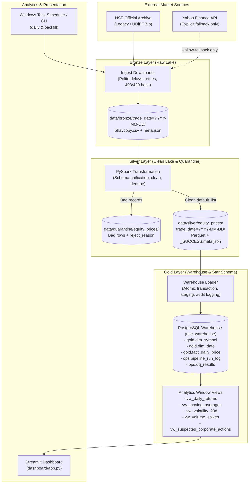

# NSE Market Data Pipeline

[](https://github.com/placeholder/nse-pipeline/actions)


An industrial-grade, idempotent batch data pipeline that ingests daily National Stock Exchange of India (NSE) Bhavcopy equity market data, standardizes legacy and modern formats using Apache Spark into Hive-partitioned Parquet storage, enforces data quality gates with dead-letter quarantine, loads a dimensional star-schema warehouse in PostgreSQL with full audit tracking, and surfaces financial analytics views via an interactive Streamlit dashboard.

---

## Architecture Overview



---

## Tech Stack & Architecture Rationale

| Component | Technology | Rationale & Why Chosen |
|---|---|---|
| **Language** | Python 3.13 | Native modern typing, structured exceptions, and broad data ecosystem compatibility. |
| **Data Processing** | Apache Spark 4.2.0 (PySpark) | Handles distributed data transformation, schema unification across legacy and modern formats, deduplication, and vectorized Parquet writes with zero data corruption. |
| **Lake Storage** | Parquet via PyArrow / Spark | Hive-partitioned (`trade_date=YYYY-MM-DD`), columnar compression, type-safe, and compatible with Pandas/DuckDB without directory schema conflicts. |
| **Warehouse** | PostgreSQL 16 (Docker) | Production ACID star schema with native window functions, robust audit logging, foreign keys, and sub-15ms analytics queries. |
| **Database Driver** | psycopg 3 (binary) | Modern, high-performance PostgreSQL driver supporting binary protocol, native type conversions, and connection parameters. |
| **Dashboard** | Streamlit 1.42.0 | Lightweight, interactive Python web interface for visualizing financial time series, market movers, sector returns, and pipeline health. |
| **Linter & Formatter**| Ruff 0.9.6 | Ultra-fast Rust-based Python linter and formatter enforcing standard PEP 8, flake8, and import sorting rules. |
| **Test Suite** | Pytest 8.3.4 | Automated unit and integration testing suite with isolated ephemeral test databases and safety isolation guards. |

---

## Data Quality Checks & Gates

| Stage | Gate / Check Name | Enforcement Type | Description |
|---|---|---|---|
| **Ingest** | `Official Source Check` | Hard Stop | Only official NSE archives are downloaded during automated pipelines. Fallback (`yfinance`) is strictly forbidden unless `--allow-fallback` is passed. |
| **Ingest** | `Rate Limit Halt` | Hard Stop | Halts immediately upon receiving HTTP 403 or 429 to protect exchange access and avoid IP bans. |
| **Transform** | `Primary Key Deduplication` | Transform | Enforces unique `(trade_date, symbol, series)` by retaining the first valid record and logging duplicates. |
| **Transform** | `Price Positivity` | Quarantine / Gate | Quarantines any rows where `open, high, low, close <= 0`. |
| **Transform** | `Logical Range Consistency`| Quarantine / Gate | Quarantines rows where `high < low` or where `open, close, last` fall outside `[low, high]`. |
| **Transform** | `Plausible Row Count` | Hard Failure | Fails transformation if output rows fall outside configured bounds (`[40, 55]` for NIFTY 50; `[500, 3000]` for full market). |
| **Transform** | `Stage Reconciliation` | Audit & Gate | Strict stage-by-stage conservation equation: $\text{Read} - \text{Filtered} - \text{Quarantined} - \text{Deduped} = \text{Clean}$. |
| **Transform** | `Reject Rate Threshold` | Hard Failure | Rejects partition if quarantined rows exceed 5% of input rows. |
| **Load** | `Universe Guard` | Hard Rejection | Rejects loading any partition whose metadata does not declare `universe = 'default_list'` (unless `--include-all-symbols` is provided). |
| **Load** | `Reconciliation Gate` | Audit & Gate | Validates that staging table rows match clean Parquet row count exactly before committing to `gold.fact_daily_price`. |
| **Load** | `Audit Logging` | Audit | Every load stage logs to `ops.pipeline_run_log` and `ops.dq_results` in an independent transaction that commits even if the data load rolls back. |

---

## Quickstart & Installation

### Prerequisites
- **Operating System:** Windows 10/11, macOS, or Linux.
- **Python:** Python 3.13.x installed with virtual environment.
- **Java:** OpenJDK 17 (`JAVA_HOME` configured).
- **Hadoop (Windows only):** `HADOOP_HOME` configured with `winutils.exe` in `C:\hadoop\bin`.
- **Docker:** Docker Desktop running.

### 1. Clone & Set Up Environment
```powershell
git clone https://github.com/placeholder/nse-pipeline.git
cd nse-pipeline

# Create virtual environment
python -m venv .venv
.\.venv\Scripts\Activate.ps1

# Install pinned dependencies
python -m pip install --upgrade pip
pip install -r requirements.txt
pip install -e .
```

### 2. Configure Environment
Copy the example environment configuration:
```powershell
Copy-Item .env.example .env
```
Ensure your `.env` contains:
```env
POSTGRES_HOST=127.0.0.1
POSTGRES_PORT=5432
POSTGRES_DB=nse_warehouse
POSTGRES_USER=postgres
POSTGRES_PASSWORD=postgres
```

### 3. Start Database & Initialize Warehouse
```powershell
# Start PostgreSQL 16 container
docker compose up -d

# Initialize schema, tables, views, and seed dimensions (dim_symbol, dim_date)
python -m nse_pipeline.cli db init
```

### 4. Run the Pipeline
```powershell
# Run single daily pipeline (resolves latest published trading session based on 19:00 IST cutoff)
python -m nse_pipeline.cli daily -q

# Or run for a specific historical date
python -m nse_pipeline.cli daily --date 2024-10-15 -q

# Run historical backfill across a date range in quiet mode
python -m nse_pipeline.cli backfill --from 2024-10-14 --to 2024-10-18 -q
```

### Sample Run & Benchmarks

Real backfill execution across 15 calendar days (10 trading sessions) in quiet mode:
```powershell
python -m nse_pipeline.cli backfill --from 2025-03-17 --to 2025-03-31 -q
```
Summary totals produced:
```
Total Days: 15 | Trading: 10 | OK: 10 | Skipped (Done): 0 | Skipped (Off): 5 | Failed: 0 | Not Attempted: 0
Execution Duration: 70.78s | Audit Report: data\reports\backfill_report_20261113_145801.json
```

Measured per-day database load breakdown (`[PROFILE]` log on 2024-10-15 using `127.0.0.1` and shared audit connection):
```
[PROFILE] Load breakdown for 2024-10-15: conn=0.013s, pyarrow_read=0.027s, staging_copy=0.008s, fact_upsert=0.006s, dq_results=0.019s, run_log=0.006s
```
Connecting via IPv4 (`127.0.0.1`) reduced connection overhead from ~3.1s to ~0.013s (~230x speedup), bypassing the Windows IPv6 DNS fallback delay.

### 5. Launch the Dashboard
```powershell
.\scripts\tasks.ps1 dashboard
# Or directly:
streamlit run dashboard/app.py --server.address 127.0.0.1
```
Open `http://localhost:8501` in your browser.

---

## Scheduling with Windows Task Scheduler

To run the pipeline daily automatically without requiring external orchestrators (Airflow/Prefect), use Windows Task Scheduler.

### Command Line Registration (`schtasks`)
Open PowerShell as Administrator and run:
```powershell
schtasks /create /tn "NSE_Daily_Pipeline" /tr "powershell.exe -ExecutionPolicy Bypass -Command \"Set-Location C:\Projects\nse-pipeline; .\.venv\Scripts\python.exe -m nse_pipeline.cli daily >> data\logs\daily_scheduler.log 2>&1\"" /sc daily /st 19:30
```

### GUI Configuration Steps
1. Press `Win + R`, type `taskschd.msc`, and press Enter.
2. Click **Create Basic Task...** in the right pane.
3. **Name:** `NSE Daily Bhavcopy Pipeline`.
4. **Trigger:** Daily at `7:30 PM` (19:30 IST, after NSE bhavcopy files are published).
5. **Action:** Start a program.
   - **Program/script:** `powershell.exe`
   - **Arguments:** `-ExecutionPolicy Bypass -Command "Set-Location C:\Projects\nse-pipeline; .\.venv\Scripts\python.exe -m nse_pipeline.cli daily >> data\logs\daily_scheduler.log 2>&1"`
6. Click **Finish**.

---

## Design Decisions (ADR Summary)

Key architectural decisions recorded in `docs/DECISIONS.md`:
1. **ADR 001 - Decoupled Ingestion & Ethical Scraping:** Isolated exchange network logic with exponential backoff and hard halts on HTTP 403/429.
2. **ADR 002 - Schema Drift Unification & Quarantine Pattern:** Unified modern UDiFF (`BhavCopy_NSE_CM_0_0_0_*.csv`) and legacy formats (`cm*bhav.csv.zip`) into a canonical schema; quarantined corrupted records into partitioned dead-letter storage.
3. **ADR 003 - Hive Partitioning via Base Directory Overwrite:** Switched to standard Spark `.partitionBy("trade_date")` to prevent nested path conflicts in PyArrow and DuckDB.
4. **ADR 004 - Deterministic Stage Reconciliation & Audit Gating:** Enforced strict balance equations before writing clean Parquet partitions.
5. **ADR 005 - PostgreSQL Star Schema & Idempotent Staging:** Implemented atomic per-day partition loading via staging tables and UPSERTs.
6. **ADR 006 - Universe Gating:** Prevented accidental loading of full-market (~1,900 stocks) partitions into the curated Nifty 50 warehouse without explicit flags.
7. **ADR 007 - Holiday Missing Coverage Warning:** Emitted clear operational alerts whenever a requested year is absent from `config/holidays.csv`.
8. **ADR 008 - Trading-Row Window Views & Corporate Action Detection:** Financial indicators operate over consecutive trading rows (`trading_day_seq`) rather than calendar day spans. Flagged suspected corporate actions via price divergence thresholds while preserving raw executed price integrity.

---

## Known Limitations & Edge Cases

1. **Explicit Implementation Boundaries:** Apache Airflow, Docker container packaging of the Python/Spark pipeline application, and cloud infrastructure deployment (AWS/GCP) are **not implemented** in this project. Orchestration is provided natively via the CLI and Windows Task Scheduler, while PostgreSQL runs in a local Docker container.
2. **Weekend Sessions and Discontinuous Returns:** The calendar treats every weekend as non-trading, so special weekend trading sessions (such as the Union Budget session on Saturday 2025-02-01) are not loaded in the standard automated schedule. As a result, price returns across weekend sessions span two trading sessions. (Check result: downloading the 2025-02-01 file with `--force` confirms an official file exists, with TRENT's close in it at 6,189.50; because this Saturday session was unpopulated in the standard weekday schedule, TRENT's Monday 2025-02-03 file had `prev_close` = 6,189.50, diverging by 7.58% from Friday's close of 5,753.20).
3. **Suspected Actions Cannot Distinguish Splits from Crashes:** The view `gold.vw_suspected_corporate_actions` flags large price moves (>20%) and `prev_close` discrepancies (>5%), but cannot algorithmically distinguish true splits/bonuses from genuine price crashes or unpopulated sessions without external corporate action master data.
4. **Unadjusted History Distorts Moving Averages:** Price history in `gold.fact_daily_price` preserves unadjusted executed cash settlement prices. Because historical prices are not backward split-adjusted, moving averages (`ma_20d`, `ma_50d`) that span a split or large corporate action show a false dip until the pre-split prices roll out of the window frame.
5. **Sparse Data History Ramp-Up:** Moving average views (`ma_20d`, `ma_50d`) and volatility views (`volatility_20d`) evaluate strictly to `NULL` until a contiguous sequence of trading sessions is present.
6. **Single-Node Execution:** Spark runs in `local[*]` mode; this is optimized for single-machine engineering workstations rather than multi-node EMR/Databricks clusters.

---

## What I Would Change at Scale

1. **Distributed Lakehouse Storage:** Migrate local filesystem Parquet partitions to Delta Lake or Apache Iceberg on Amazon S3 / Google Cloud Storage with ACID merge capabilities.
2. **Modern Orchestration:** Migrate Windows Task Scheduler / CLI runs to Dagster or Apache Airflow with dynamic assets, automated retries, and Slack alerts.
3. **Cloud Data Warehouse:** Switch PostgreSQL 16 to Snowflake, Google BigQuery, or Amazon Redshift for multi-terabyte analytical queries across decades of tick data.
4. **Corporate Action Adjustment Engine:** Implement an automated corporate actions master feed that generates split/bonus adjustment factors and backward-adjusts price series in a dedicated adjusted price view.

---

## Screenshots Placeholder

Screenshots of the Streamlit dashboard are maintained in `docs/images/`:
- `docs/images/dashboard_overview.png` - Overview cards, data freshness status, and KPI summary.
- `docs/images/stock_explorer.png` - Moving averages (20d/50d SMA), volume charts, and daily return history.
- `docs/images/corporate_actions.png` - Suspected corporate actions view (large price movements and prev_close discrepancies).

---

## Data & Disclaimer

This data engineering pipeline is created strictly for **educational and portfolio demonstration purposes**. Market data processed by this pipeline is sourced from public National Stock Exchange of India (NSE) daily historical archives. This project is not affiliated with, endorsed by, or sponsored by the National Stock Exchange of India Ltd.

**Not Investment Advice:** Nothing in this repository constitutes financial, investment, legal, or tax advice. All data and calculations are provided as-is without warranty of any kind.
